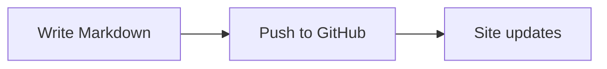

# Writing pages

## Adding a page

1. Create a Markdown file under `docs/`, in a topic folder, e.g. `docs/git/rebase.md`.
2. Add it to the `nav` section of `mkdocs.yml` so it shows up in the navigation.
3. Preview it with `zensical serve`, then commit and push.

## Formatting cheat sheet

### Callouts

!!! note
    A note callout.

!!! tip "Custom title"
    A tip with its own title.

??? warning "Collapsible"
    Hidden until clicked.

### Code with a copy button

```bash
zensical serve
```

### Tabs

=== "Linux"

    ```bash
    sudo apt install git
    ```

=== "macOS"

    ```bash
    brew install git
    ```

### Task lists

- [x] Set up the wiki
- [ ] Write the first real note

### Diagrams



### Math

Inline math goes between single dollar signs, like $E = mc^2$. Display math goes between double dollar signs:

$$
\int_0^\infty e^{-x^2} \, dx = \frac{\sqrt{\pi}}{2}
$$
