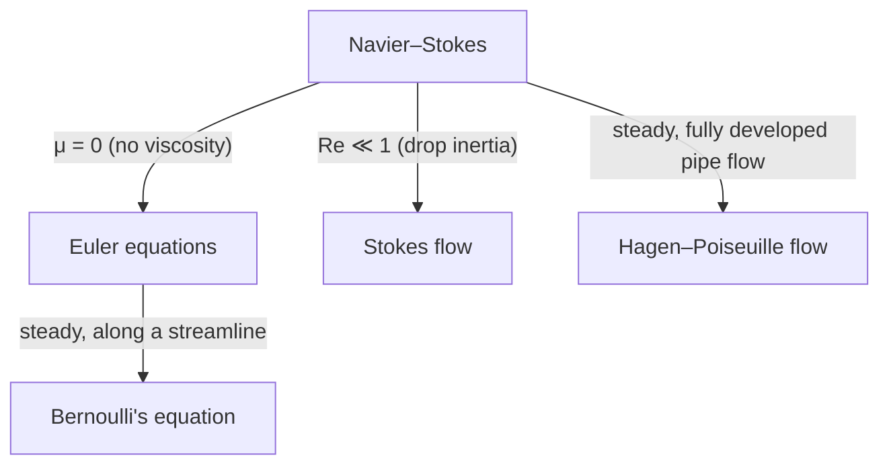

# Navier–Stokes equations

The Navier–Stokes equations describe how the velocity and pressure of a viscous fluid change over time. They are Newton's second law, $F = ma$, applied to a small parcel of fluid.

!!! abstract "In one sentence"
    Mass is conserved, and a fluid parcel accelerates because of pressure differences, viscous friction and body forces such as gravity.

Named after Claude-Louis Navier (1822) and George Gabriel Stokes (1845).

## Assumptions

- **Continuum:** the fluid is treated as continuous, not as individual molecules. Valid when the mean free path is much smaller than the length scales of the flow.
- **Newtonian fluid:** viscous stress is proportional to the rate of strain. Holds well for water, air and most simple fluids; not for blood, paint or toothpaste.

## Incompressible form

For a fluid of constant density $\rho$ (a good approximation for liquids, and for gases well below the speed of sound):

$$
\rho \left( \frac{\partial \mathbf{u}}{\partial t} + (\mathbf{u} \cdot \nabla)\, \mathbf{u} \right)
= -\nabla p + \mu \nabla^2 \mathbf{u} + \mathbf{f}
$$

$$
\nabla \cdot \mathbf{u} = 0
$$

The first equation is conservation of momentum; the second is conservation of mass (the continuity equation). Together they are four equations for four unknowns: the three components of $\mathbf{u}$ and the pressure $p$.

| Symbol | Meaning | SI unit |
|---|---|---|
| $\mathbf{u}$ | velocity field | m/s |
| $p$ | pressure | Pa |
| $\rho$ | density | kg/m³ |
| $\mu$ | dynamic viscosity | Pa·s |
| $\nu = \mu / \rho$ | kinematic viscosity | m²/s |
| $\mathbf{f}$ | body force per unit volume, e.g. $\rho \mathbf{g}$ | N/m³ |

### What each term means

| Term | Name | Physical meaning |
|---|---|---|
| $\rho \, \partial \mathbf{u} / \partial t$ | unsteady acceleration | velocity changing in time at a fixed point |
| $\rho (\mathbf{u} \cdot \nabla) \mathbf{u}$ | convective acceleration | velocity changing as the parcel moves to a new place; **nonlinear** |
| $-\nabla p$ | pressure gradient | fluid is pushed from high to low pressure |
| $\mu \nabla^2 \mathbf{u}$ | viscous diffusion | friction smooths out velocity differences |
| $\mathbf{f}$ | body force | gravity, electromagnetic forces, … |

The left-hand side is often written with the **material derivative**, the rate of change following a fluid parcel:

$$
\frac{D \mathbf{u}}{D t} = \frac{\partial \mathbf{u}}{\partial t} + (\mathbf{u} \cdot \nabla)\, \mathbf{u}
$$

### Component form

In Cartesian coordinates, the $x$-component of the momentum equation is

$$
\rho \left( \frac{\partial u}{\partial t} + u \frac{\partial u}{\partial x} + v \frac{\partial u}{\partial y} + w \frac{\partial u}{\partial z} \right)
= -\frac{\partial p}{\partial x}
+ \mu \left( \frac{\partial^2 u}{\partial x^2} + \frac{\partial^2 u}{\partial y^2} + \frac{\partial^2 u}{\partial z^2} \right)
+ f_x
$$

and the $y$- and $z$-components follow the same pattern for $v$ and $w$.

## Where they come from

Start from the **Cauchy momentum equation**, which holds for any continuum:

$$
\rho \frac{D \mathbf{u}}{D t} = \nabla \cdot \boldsymbol{\sigma} + \mathbf{f}
$$

Split the stress tensor $\boldsymbol{\sigma}$ into pressure and viscous parts, $\boldsymbol{\sigma} = -p \mathbf{I} + \boldsymbol{\tau}$. For a Newtonian fluid the viscous stress is

$$
\boldsymbol{\tau} = \mu \left( \nabla \mathbf{u} + (\nabla \mathbf{u})^{\mathsf{T}} \right) - \tfrac{2}{3} \mu (\nabla \cdot \mathbf{u}) \mathbf{I}
$$

(using Stokes' hypothesis that the bulk viscosity is zero). With constant $\mu$ and $\nabla \cdot \mathbf{u} = 0$, the divergence of $\boldsymbol{\tau}$ reduces to $\mu \nabla^2 \mathbf{u}$, which gives the incompressible equations above.

## Compressible form

When density varies (high-speed gas flow, acoustics, combustion), mass conservation becomes

$$
\frac{\partial \rho}{\partial t} + \nabla \cdot (\rho \mathbf{u}) = 0
$$

and momentum conservation keeps the full stress tensor:

$$
\rho \frac{D \mathbf{u}}{D t} = -\nabla p + \nabla \cdot \boldsymbol{\tau} + \mathbf{f}
$$

This system needs two more relations to be closed: an **energy equation** and an **equation of state**, such as the ideal gas law $p = \rho R T$.

## Dimensionless form and the Reynolds number

Scale lengths by $L$, velocities by $U$, time by $L/U$ and pressure by $\rho U^2$. Writing the scaled quantities with a star, the incompressible equations without body forces become

$$
\frac{\partial \mathbf{u}^*}{\partial t^*} + (\mathbf{u}^* \cdot \nabla^*)\, \mathbf{u}^*
= -\nabla^* p^* + \frac{1}{Re} \nabla^{*2} \mathbf{u}^*
$$

with the **Reynolds number**

$$
Re = \frac{\rho U L}{\mu} = \frac{U L}{\nu} = \frac{\text{inertial forces}}{\text{viscous forces}}
$$

| Regime | What it looks like | Example |
|---|---|---|
| $Re \ll 1$ | smooth, viscosity dominates | bacteria swimming, honey pouring |
| moderate $Re$ | laminar, ordered layers | slow flow in a thin tube |
| $Re \gg 1$ | inertia dominates, often turbulent | rivers, airflow around a car |

For flow in a round pipe, the transition from laminar to turbulent typically happens around $Re \approx 2300$, using the pipe diameter as $L$.

## Special cases

**[Euler equations](euler-equations.md)** (inviscid flow, $\mu = 0$):

$$
\rho \frac{D \mathbf{u}}{D t} = -\nabla p + \mathbf{f}
$$

**Stokes flow** (creeping flow, $Re \ll 1$): the nonlinear term disappears and the equations become linear:

$$
\mu \nabla^2 \mathbf{u} = \nabla p, \qquad \nabla \cdot \mathbf{u} = 0
$$

## Worked example: flow in a pipe

Steady, laminar flow through a long straight pipe of radius $R$, driven by a constant pressure drop $G = -\,dp/dx > 0$. By symmetry the velocity points along the pipe and depends only on the distance $r$ from the axis, so the convective term vanishes and the $x$-momentum equation reduces to

$$
\frac{\mu}{r} \frac{d}{dr} \left( r \frac{du}{dr} \right) = -G
$$

With no-slip at the wall, $u(R) = 0$, and finite velocity on the axis, the solution is a parabola:

$$
u(r) = \frac{G}{4\mu} \left( R^2 - r^2 \right)
$$

Integrating over the cross-section gives the volume flow rate, the **Hagen–Poiseuille law**:

$$
Q = \frac{\pi R^4 G}{8 \mu}
$$

!!! tip "Why it matters"
    $Q \propto R^4$: halving a pipe's radius cuts the flow to one sixteenth at the same pressure drop. This is why narrowed blood vessels matter so much.

## Boundary conditions

- **No-slip:** at a solid wall the fluid moves with the wall, $\mathbf{u} = \mathbf{u}_\text{wall}$ (zero for a fixed wall).
- **Inflow / outflow:** prescribed velocity or pressure on open boundaries.
- **Free surface:** zero shear stress, and normal stress balanced by surface tension.

## Solving them in practice

Exact solutions exist only for simple geometries (pipe, channel and Couette flow, and a few others). Real problems are solved numerically, which is the field of **computational fluid dynamics (CFD)**:

- **Methods:** finite volume (most common in engineering), finite element, spectral methods.
- **Pressure–velocity coupling:** incompressible flow has no separate equation for pressure, so solvers use algorithms such as SIMPLE or projection methods.
- **Turbulence:** resolving every eddy (direct numerical simulation, DNS) is very expensive, so most simulations model turbulence: RANS models such as $k$–$\varepsilon$ or $k$–$\omega$ SST, or large eddy simulation (LES).
- **Tools:** OpenFOAM (open source), ANSYS Fluent, COMSOL, SU2.

## An open problem

!!! question "Millennium Prize Problem"
    It is still not known whether smooth solutions to the 3D incompressible Navier–Stokes equations always exist for all time, or whether they can develop singularities. The Clay Mathematics Institute offers a US$1 million prize for a proof either way.

## Further reading

- G. K. Batchelor, *An Introduction to Fluid Dynamics*, Cambridge University Press, 1967.
- L. D. Landau and E. M. Lifshitz, *Fluid Mechanics* (Course of Theoretical Physics, vol. 6).
- F. M. White, *Viscous Fluid Flow*, McGraw-Hill.
- Clay Mathematics Institute: [Navier–Stokes existence and smoothness](https://www.claymath.org/millennium/navier-stokes-equation/)
