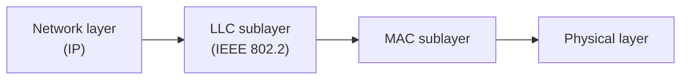

# MAC layer

The **Medium Access Control (MAC)** layer decides how devices on the same local network share the physical medium and how they address each other. It is the lower part of the data link layer (layer 2) in the OSI model.

!!! abstract "In one sentence"
    The MAC layer wraps packets into frames, labels them with hardware addresses, checks them for errors, and makes sure devices sharing a cable or radio channel take turns.

## Where it sits

The IEEE 802 standards split the data link layer in two:



In practice, Ethernet usually skips LLC and marks the network protocol directly with the **EtherType** field in the MAC header.

## What it does

| Job | How |
|---|---|
| **Framing** | Wraps a network-layer packet with a header and trailer so the receiver knows where a frame starts and ends |
| **Addressing** | Puts the source and destination MAC addresses in every frame |
| **Medium access** | Decides who may transmit when, and resolves collisions |
| **Error detection** | Adds a CRC-32 checksum (the FCS); frames that fail the check are dropped, not repaired |

## MAC addresses

A MAC address is a 48-bit identifier (EUI-48), usually written as six hexadecimal bytes: `3c:22:fb:1a:9e:04` or `3C-22-FB-1A-9E-04`.

| Part | Bits | Meaning |
|---|---|---|
| OUI | first 24 | Organizationally Unique Identifier, assigned to the manufacturer by IEEE |
| NIC-specific | last 24 | chosen by the manufacturer for each device |

Two bits in the **first byte** have special meanings:

| Bit | Value 0 | Value 1 |
|---|---|---|
| Least significant: **I/G** | individual (unicast) | group (multicast) |
| Second least significant: **U/L** | universally administered (from the manufacturer) | locally administered (set by software) |

Special addresses:

- **Broadcast:** `ff:ff:ff:ff:ff:ff`, received by every device on the local network.
- **Multicast:** any address with the I/G bit set, e.g. `01:00:5e:…` for IPv4 multicast and `33:33:…` for IPv6 multicast.

!!! tip "Randomized MAC addresses"
    Phones and laptops now often use a random, locally administered MAC address for each Wi-Fi network, so they can't be tracked from network to network. You can spot one by the second hex digit: `2`, `6`, `a` or `e` means the U/L bit is set.

MAC addresses only matter **within one local network**. Routers replace the MAC header at every hop, while the IP addresses stay the same end to end.

## Ethernet frame (IEEE 802.3)

Fields in the order they are sent:

| Field | Size | Purpose |
|---|---|---|
| Preamble | 7 B | alternating 1s and 0s so the receiver can synchronise its clock |
| Start frame delimiter (SFD) | 1 B | marks the start of the frame |
| Destination address | 6 B | who the frame is for |
| Source address | 6 B | who sent it |
| 802.1Q tag | 4 B | optional VLAN tag: 12-bit VLAN ID (1–4094 usable) and 3-bit priority |
| EtherType / Length | 2 B | values ≥ `0x0600` name the payload protocol; values ≤ 1500 give the payload length (old 802.3 frames) |
| Payload | 46–1500 B | the packet being carried, padded up to 46 bytes if shorter |
| Frame check sequence (FCS) | 4 B | CRC-32 over the frame from destination to payload |

- **Minimum frame:** 64 bytes from destination through FCS.
- **Maximum frame:** 1518 bytes, or 1522 with a VLAN tag. "Jumbo frames" of about 9000 bytes are a common non-standard extension.
- **Interframe gap:** at least 12 bytes of idle time between frames.

Common EtherTypes:

| EtherType | Protocol |
|---|---|
| `0x0800` | IPv4 |
| `0x0806` | ARP |
| `0x86DD` | IPv6 |
| `0x8100` | 802.1Q VLAN tag |
| `0x88CC` | LLDP |

### Worked example: Ethernet efficiency

Each frame costs 38 bytes on the wire beyond its payload: 8 bytes of preamble and SFD, 14 of header, 4 of FCS and 12 of interframe gap. So the best-case share of the link carrying useful data is

$$
\text{max payload: } \frac{1500}{1500 + 38} \approx 97.5\%
\qquad
\text{min payload: } \frac{46}{46 + 38} \approx 54.8\%
$$

On a 1 Gb/s link that means at most about 975 Mb/s of payload, before IP and TCP headers take their share.

## Medium access methods

When several devices share one medium, they need rules for who transmits when. There are three families.

### Channel partitioning

Split the channel into fixed pieces, one per device:

- **TDMA:** time slots (classic GSM)
- **FDMA:** frequency bands
- **CDMA:** codes, all transmitting at once (3G)

No collisions, but capacity is wasted when a device has nothing to send.

### Random access

Transmit when you have data, and recover from collisions.

**ALOHA** (1971, University of Hawaii) simply transmits and retries after a random delay. With many devices the best achievable throughput is

$$
S_\text{pure} = \frac{1}{2e} \approx 18.4\%,
\qquad
S_\text{slotted} = \frac{1}{e} \approx 36.8\%
$$

**CSMA/CD** (carrier sense multiple access with collision detection) was used by classic shared Ethernet:

1. Listen. If the medium is busy, wait until it is idle.
2. Transmit, and keep listening while transmitting.
3. If a collision is detected, stop and send a short jam signal.
4. After the $n$-th collision, pick a random $K$ from $\{0, 1, \dots, 2^{\min(n, 10)} - 1\}$ and wait $K \times 512$ bit times (**binary exponential backoff**). Give up after 16 attempts.

The **64-byte minimum frame** exists for CSMA/CD: a frame must last long enough (512 bit times, 51.2 µs at 10 Mb/s) for the sender to still be transmitting when a collision from the far end of the cable reaches it.

!!! note
    Modern Ethernet is **switched and full-duplex**: every device has its own link to a switch and can send and receive at the same time, so collisions can't happen and CSMA/CD is no longer used.

**CSMA/CA** (collision avoidance) is used by Wi-Fi (IEEE 802.11). A radio can't reliably hear collisions while transmitting, so Wi-Fi tries to avoid them instead:

1. Wait until the channel has been idle for a fixed time (DIFS).
2. Count down a random backoff, pausing whenever the channel becomes busy.
3. Transmit the whole frame.
4. The receiver replies with an **ACK**. No ACK means assume a collision, double the contention window and retry.

Optionally, a short **RTS/CTS** exchange (request to send / clear to send) reserves the channel first. This solves the **hidden node problem**: two stations that can both reach the access point but can't hear each other.

### Taking turns

- **Polling:** a controller asks each device in turn (Bluetooth).
- **Token passing:** a token circulates and only its holder may transmit (Token Ring, IEEE 802.5; FDDI).

## Switches and MAC learning

A switch forwards frames by MAC address using a **MAC address table** (also called a CAM table or forwarding database):

1. **Learn:** when a frame arrives, record its source address and the port it came in on.
2. **Forward:** if the destination address is in the table, send the frame out of that port only.
3. **Flood:** if the destination is unknown, or is broadcast or multicast, send it out of every port except the incoming one.
4. **Age:** forget entries not seen for a while (300 seconds by default).

Because flooding would loop forever in a network with redundant links, switches run the **Spanning Tree Protocol** (STP, IEEE 802.1D; or the faster RSTP, 802.1w) to block redundant paths.

## From IP addresses to MAC addresses

To send an IP packet on the local network, a host must know the next hop's MAC address:

- **IPv4** uses **ARP**: broadcast "who has 192.168.1.1?", and the owner replies with its MAC address.
- **IPv6** uses **Neighbor Discovery** (NDP), with ICMPv6 messages sent to multicast addresses instead of a broadcast.

Results are cached in the neighbour (ARP) table.

## Useful commands

=== "Linux"

    ```bash
    ip link show              # interfaces and their MAC addresses
    ip neigh                  # ARP / neighbour table
    bridge fdb show           # MAC table of a Linux bridge
    sudo tcpdump -e -i eth0   # capture frames, showing MAC headers
    ```

=== "macOS"

    ```bash
    ifconfig en0 | grep ether   # MAC address of en0
    arp -a                      # ARP table
    sudo tcpdump -e -i en0      # capture frames, showing MAC headers
    ```

=== "Windows"

    ```powershell
    getmac /v                   # interfaces and their MAC addresses
    arp -a                      # ARP table
    Get-NetNeighbor             # neighbour table (PowerShell)
    ```

## Further reading

- J. F. Kurose and K. W. Ross, *Computer Networking: A Top-Down Approach*, chapter 6 (the link layer).
- A. S. Tanenbaum and D. J. Wetherall, *Computer Networks*, chapter 4 (the medium access control sublayer).
- R. Perlman, *Interconnections: Bridges, Routers, Switches, and Internetworking Protocols*.
- IEEE 802.3 (Ethernet) and IEEE 802.11 (Wi-Fi) standards.
