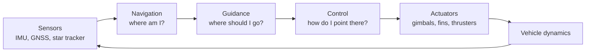

# Guidance, navigation and control

Guidance, navigation and control (GNC) is the "brain" of a rocket: it works out where the vehicle is, decides where it should be heading, and steers it there, many times per second.

!!! abstract "In one sentence"
    **Navigation** estimates position, velocity and attitude; **guidance** turns that into a desired direction of thrust; **control** moves the engines and fins so the vehicle actually points that way.

## The GNC loop

The three parts run at different speeds. Control is the fastest (often 50–500 Hz), because a rocket is unstable and must be corrected constantly. Navigation runs at similar rates. Guidance can run slower (around 1–10 Hz), because the ideal path changes gradually.

| Part | Question | Output |
|---|---|---|
| Navigation | Where am I, how fast am I going, which way am I pointing? | Position, velocity and attitude estimates |
| Guidance | Which way should I thrust to reach the target orbit or landing spot? | Desired attitude (thrust direction), throttle, engine cut-off time |
| Control | How do I make the vehicle follow that command? | Gimbal angles, fin deflections, thruster firings |

## Navigation

### Inertial navigation

The core of almost every rocket's navigation is an **inertial measurement unit (IMU)**: three **gyroscopes** measuring rotation rate and three **accelerometers** measuring acceleration, along three perpendicular axes. Starting from a known position on the pad, the computer integrates these measurements to track the vehicle with no outside help. This is **dead reckoning**:

$$
\dot{\mathbf{q}} = \tfrac{1}{2}\, \mathbf{q} \otimes \boldsymbol{\omega},
\qquad
\dot{\mathbf{v}} = \mathbf{C}(\mathbf{q})\, \mathbf{f} + \mathbf{g}(\mathbf{r}),
\qquad
\dot{\mathbf{r}} = \mathbf{v}
$$

| Symbol | Meaning |
|---|---|
| $\mathbf{q}$ | attitude, as a unit quaternion |
| $\boldsymbol{\omega}$ | rotation rate measured by the gyros |
| $\mathbf{f}$ | specific force measured by the accelerometers (body axes) |
| $\mathbf{C}(\mathbf{q})$ | rotation from body axes to the navigation frame |
| $\mathbf{g}(\mathbf{r})$ | gravity at the current position, from a model |
| $\mathbf{r}$, $\mathbf{v}$ | position and velocity |

!!! note "Accelerometers cannot feel gravity"
    An accelerometer in free fall reads zero, and one sitting on the pad reads 1 g *upwards*. It measures **specific force**: every force except gravity, divided by mass. That is why navigation adds gravity back from a model, $\mathbf{g}(\mathbf{r})$, and why an error in position also causes an error in the gravity that is added.

Two hardware layouts exist:

- **Gimballed platform**: the sensors sit on a platform kept fixed in space by gimbals and motors (Saturn V, Apollo). Accurate, but heavy and mechanical.
- **Strapdown**: the sensors are bolted to the vehicle and the computer does the rotation maths. Lighter and simpler; standard since the 1980s, made possible by fast computers and better gyros.

Gyro technologies, from older to newer: spinning-mass gyros, **ring laser gyros** and **fibre-optic gyros** (which measure rotation from the interference of light travelling round a loop in both directions), and tiny **MEMS** gyros on a chip, used in small rockets and drones.

### Drift and aiding

Integration piles up errors: a small constant accelerometer bias $b$ becomes a position error of $\tfrac{1}{2} b t^2$. For a bias of $10^{-4}$ g (about 1 mm/s²), after 10 minutes:

$$
\tfrac{1}{2} \cdot 10^{-3} \cdot 600^2 \approx 180 \text{ m}
$$

That is fine for an ascent to orbit, which lasts about 10 minutes, but not for a long mission or a precise landing. So the inertial solution is corrected (**aided**) with outside measurements:

- **GNSS** (GPS, Galileo, GLONASS, BeiDou): position and velocity, with special receivers that work at rocket speeds
- **Star trackers**: cameras that recognise star patterns to give attitude to arc-second accuracy
- **Radar and laser altimeters**, and cameras that recognise terrain, for landings

### The Kalman filter

The standard way to blend inertial and outside measurements is the **Kalman filter**. It keeps an estimate $\hat{\mathbf{x}}$ of the state and its uncertainty, the covariance matrix $\mathbf{P}$, and alternates two steps:

**Predict** using the motion model (the inertial equations above):

$$
\hat{\mathbf{x}}^- = \mathbf{F}\, \hat{\mathbf{x}},
\qquad
\mathbf{P}^- = \mathbf{F} \mathbf{P} \mathbf{F}^\top + \mathbf{Q}
$$

**Update** when a measurement $\mathbf{z}$ arrives:

$$
\mathbf{K} = \mathbf{P}^- \mathbf{H}^\top \left( \mathbf{H} \mathbf{P}^- \mathbf{H}^\top + \mathbf{R} \right)^{-1}
$$

$$
\hat{\mathbf{x}} = \hat{\mathbf{x}}^- + \mathbf{K} \left( \mathbf{z} - \mathbf{H} \hat{\mathbf{x}}^- \right),
\qquad
\mathbf{P} = (\mathbf{I} - \mathbf{K} \mathbf{H})\, \mathbf{P}^-
$$

| Symbol | Meaning |
|---|---|
| $\mathbf{F}$ | how the state evolves over one time step |
| $\mathbf{Q}$ | process noise: how much the model is trusted |
| $\mathbf{H}$ | what the sensor measures, as a function of the state |
| $\mathbf{R}$ | measurement noise: how much the sensor is trusted |
| $\mathbf{K}$ | Kalman gain: how far to move the estimate toward the measurement |

The gain does the balancing automatically: a precise sensor (small $\mathbf{R}$) pulls the estimate strongly; a noisy one barely moves it. Real rockets use the **extended Kalman filter**, which linearises the non-linear equations around the current estimate. The Kalman filter flew on Apollo, one of its first big applications.

## Guidance

### Getting to orbit

A launch vehicle climbs vertically to clear the pad, then must turn almost horizontal: orbit is mostly about horizontal speed. Ascent guidance is usually split in two phases.

**In the atmosphere: open loop.** The rocket follows a pitch-angle program planned before launch, adjusted for the day's measured winds. A short **pitch-over** manoeuvre tips it a few degrees, then it flies a **gravity turn**: thrust stays aligned with the velocity (zero angle of attack) and gravity gradually bends the path toward horizontal. Keeping the angle of attack near zero minimises sideways aerodynamic loads, especially near **max-Q**, the moment of greatest dynamic pressure $q = \tfrac{1}{2}\rho v^2$, typically about a minute after lift-off.

**Above the atmosphere: closed loop.** Once loads no longer matter, the guidance computer repeatedly solves for the best way to reach the target orbit from the current state, and updates the answer every second or so. For a flat Earth with constant gravity the fuel-optimal steering law is the **linear tangent law**:

$$
\tan \theta(t) = a + b\, t
$$

where $\theta$ is the pitch angle of the thrust and $a$, $b$ are chosen so the vehicle arrives at the target altitude and velocity. Real algorithms extend this idea to a round Earth: the **Iterative Guidance Mode** of the Saturn V and the **Powered Explicit Guidance** (PEG) of the Space Shuttle are classic examples. Because they re-plan from the current state, they absorb engine underperformance and even engine failures: Saturn V's guidance reached orbit on Apollo 13 after a second-stage engine shut down early.

### Where Δv is lost

The [rocket equation](rocket-engines.md#the-rocket-equation) gives ideal Δv. Guidance tries to minimise the losses that eat into it:

$$
\Delta v_\text{ideal} = \Delta v_\text{orbit} + \underbrace{\int g \sin\gamma \, dt}_\text{gravity loss} + \underbrace{\int \frac{D}{m}\, dt}_\text{drag loss} + \text{steering loss}
$$

where $\gamma$ is the flight-path angle above horizontal and $D$ the drag. Gravity loss (typically 1–1.5 km/s) favours turning horizontal early; drag loss (100–200 m/s) favours climbing out of the thick air quickly; steering loss comes from thrusting away from the velocity direction. The ascent trajectory is a compromise between them.

### Landing

Propulsive landing reverses the problem: arrive at a point on the ground with zero velocity, upright, without running out of propellant. Apollo's lunar module flew polynomial guidance laws that shaped the descent trajectory in real time. Modern reusable boosters solve a **convex optimisation** problem on board, which finds a fuel-optimal path while respecting limits on thrust, tilt and glide slope, and re-solve it as the vehicle descends.

## Control

### A rocket is an inverted pendulum

The engines push from the bottom, and on most rockets the aerodynamic **centre of pressure** sits ahead of the **centre of mass** in thick air. Both make the vehicle naturally **unstable**: a small tilt grows unless it is constantly corrected, like balancing a broom on your hand. Model rockets avoid this with large tail fins that move the centre of pressure behind the centre of mass; large launch vehicles rely on active control.

### Actuators

| Actuator | How it turns the vehicle | Used for |
|---|---|---|
| Thrust vector control (TVC) | Swivels (gimbals) the engine a few degrees so thrust passes to one side of the centre of mass | Main steering during powered flight |
| Differential throttle | Throttles some engines of a cluster up and others down | Multi-engine stages |
| Vernier engines | Small extra steerable engines | Older designs (Atlas, Soyuz) |
| Fins and grid fins | Deflect airflow | Steering in the atmosphere, booster return |
| Reaction control system (RCS) | Small thrusters, or cold-gas jets, fired in pairs | Attitude in space, roll control, coasting |

### Worked example: how fast can a gimbal turn a rocket?

Take a booster with thrust $F = 7.6$ MN, mass 549 t, length 70 m, and the engine 30 m below the centre of mass. Gimbal the engines by $\delta = 1°$:

$$
\tau = F\, \ell \sin\delta = 7.6 \times 10^6 \cdot 30 \cdot \sin 1° \approx 4.0 \times 10^6 \text{ N·m}
$$

Treating the rocket as a uniform rod, $I = \tfrac{1}{12} m L^2 \approx 2.2 \times 10^8$ kg·m², so

$$
\ddot{\theta} = \frac{\tau}{I} \approx 0.018 \text{ rad/s}^2 \approx 1\,°/\text{s}^2
$$

A one-degree gimbal changes the pitch rate by about one degree per second, every second: plenty for steering, which is why a few degrees of gimbal range is enough.

### The control law

At its simplest, each axis is controlled by a **PID**-style law that turns the attitude error $e = \theta_\text{cmd} - \theta$ into a gimbal command:

$$
\delta = K_p\, e + K_d\, \dot{e} + K_i \int e \, dt
$$

The proportional term pulls toward the command, the derivative term damps oscillation, and the integral term removes steady offsets such as a constant crosswind. The gains change during flight because the vehicle changes a lot: mass drops by a factor of 10 or more, the centre of mass moves, and the aerodynamic forces rise and fall around max-Q (**gain scheduling**).

Real control systems also have to handle:

- **Structural bending**: a long, thin rocket flexes like a beam. If the IMU feels the bending and the controller fights it, the two can reinforce each other, so filters remove the bending frequencies from the sensor signal.
- **Propellant slosh**: liquid swinging in the tanks pushes the vehicle around; tanks have baffles, and the controller is tuned away from the slosh frequencies.
- **Delays and actuator limits**: gimbals have limited range and speed, and every millisecond of delay erodes the stability margin.

## A short history

| Era | Milestone |
|---|---|
| 1940s | V-2: gyroscopes, an integrating accelerometer to cut the engine at the planned speed, and analogue electronics |
| 1960s | Saturn V and Apollo: gimballed inertial platforms, digital flight computers, Iterative Guidance Mode; the Apollo Guidance Computer flew a Kalman filter to the Moon |
| 1980s | Space Shuttle: Powered Explicit Guidance, fly-by-wire control, redundant computers voting on every decision |
| 2000s–now | Strapdown IMUs with GNSS aiding, fault-tolerant commercial computers, onboard optimisation for propulsive landing and booster reuse |

## Further reading

- R. H. Battin, *An Introduction to the Mathematics and Methods of Astrodynamics*: guidance theory by one of the Apollo guidance designers
- D. Titterton and J. Weston, *Strapdown Inertial Navigation Technology*
- B. Wie, *Space Vehicle Dynamics and Control*
- F. O'Brien, *The Apollo Guidance Computer: Architecture and Operation*
