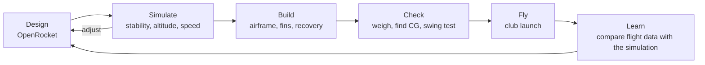

# Model rockets

Building and flying your own rocket is the hands-on side of everything in this section: you choose a motor, design for stability, add a recovery system and, if you like, fly your own electronics.

!!! abstract "In one sentence"
    Design and simulate in OpenRocket, build from tubes, fins and a nose cone, fly a **commercial** motor, bring the rocket back under a parachute, and do it at a club launch under a safety code.

!!! warning "Buy motors, don't make them"
    Hobbyists fly certified commercial motors. Making your own motors is a separate, advanced activity that is restricted by law in most countries and only done under specialist programmes (for example Tripoli Research in the USA). Rules on buying motors and on airspace also differ a lot between countries: check yours before you fly.

## The workflow

## Design and simulation software

| Tool | What it does | Cost |
|---|---|---|
| **OpenRocket** | The standard tool: design the rocket from parts, then simulate altitude, speed, stability and when the parachute opens | Free |
| **RockSim** | Commercial alternative with a large parts library | Paid |
| **RASAero II** | More accurate drag and stability at high and supersonic speeds | Free |
| **thrustcurve.org** | Database of commercial motors and their measured thrust curves; files load straight into OpenRocket | Free |
| **CAD** (FreeCAD, Fusion 360, Onshape) | Custom parts such as fin cans, nose cones and electronics sleds, often for 3D printing | Free tiers |

### An OpenRocket walkthrough

1. **Start with the body.** Add a nose cone, a body tube and a set of fins. Pick standard tube sizes (for example BT-50, BT-60, or 29/38/54 mm) so you can buy matching parts.
2. **Add the inside parts.** A motor mount tube with centering rings, a parachute or streamer, and a shock cord. Mark the motor mount as a motor mount so motors can be loaded.
3. **Override masses** with real weights once you have them; glue and paint usually add 10–20 % to what the parts list says.
4. **Choose a motor** in the motor selector (data from thrustcurve.org) and pick the **ejection delay** OpenRocket suggests, so the parachute comes out close to the highest point.
5. **Check stability.** OpenRocket shows the centre of mass (CG, blue-and-white circle) and the centre of pressure (CP, red dot) and the margin between them, in **calibers**.
6. **Run simulations** with realistic wind (3–5 m/s) and read off apogee, maximum speed, speed leaving the launch rod and descent rate.

## Stability

A rocket flies straight only if the **centre of pressure** (where the aerodynamic forces act) is **behind** the **centre of mass**. Then any tilt makes the airflow push the tail back into line, like a weathervane or the feathers of an arrow. Fins move the CP rearward. A full-size launch vehicle can fly unstable because its control system corrects it constantly (see [guidance, navigation and control](guidance.md#a-rocket-is-an-inverted-pendulum)); a model rocket usually relies on its fins.

The **stability margin** is measured in body diameters (calibers):

$$
\text{SM} = \frac{x_{CP} - x_{CG}}{d}
$$

where $x$ is measured from the nose tip and $d$ is the body diameter.

| Margin | Behaviour |
|---|---|
| Below 1 caliber | Marginal or unstable: can loop, spiral or cartwheel |
| **1–2 calibers** | **The usual target** |
| Well above 2 | Over-stable: turns strongly into the wind ("weathercocking") and loses altitude |

**Example:** a 40 mm rocket has its CG 500 mm and its CP 580 mm from the nose tip: $\text{SM} = 80 / 40 = 2.0$ calibers.

Things to remember:

- The CG moves **forward** during the flight as propellant burns, so stability normally improves. Check it with the **heaviest motor** you plan to fly, loaded.
- Find the real CG by balancing the finished rocket, with motor and parachute, on a finger or a string.
- **Swing test** for small rockets: tie a string around the rocket at its CG and swing it in a circle around you. A stable rocket points forward into the airflow; one that wobbles or tumbles needs more margin.
- If the margin is too small: add nose weight (clay in the nose cone) or enlarge the fins.

## Motors

Commercial motors are labelled with a code such as **C6-5**:

| Part | Meaning |
|---|---|
| **C** | Total impulse class: each letter doubles the maximum impulse |
| **6** | Average thrust in newtons |
| **5** | Delay in seconds between burn-out and the ejection charge that deploys the parachute |

| Class | Total impulse (N·s) | Typical use |
|---|---|---|
| ½A, A | up to 2.5 | First small rockets |
| B, C | 2.5–10 | Most small kits |
| D, E | 10–40 | Larger low-power rockets |
| F, G | 40–160 | Mid power |
| H, I | 160–640 | High power: first certification level (USA: Level 1) |
| J, K, L | 640–5120 | Second level |
| M and above | over 5120 | Third level |

Total impulse relates directly to the [rocket engines](rocket-engines.md#specific-impulse) page: impulse = average thrust × burn time.

| Manufacturer | Motors |
|---|---|
| Estes | Black-powder motors, classes ½A–E: the place to start |
| AeroTech | Composite single-use and reloadable motors, from low to high power |
| Cesaroni (Pro series) | Reloadable composite motors, mid and high power |
| Klima | Black-powder motors, widely sold in Europe |

### Two launch rules of thumb

- **Thrust-to-weight of at least 5:1** at lift-off. For example a C6 (6 N average) suits a rocket of up to about 120 g.
- **Leave the rod or rail at 15 m/s or more**, so the fins have enough airflow to stabilise the rocket. OpenRocket reports this speed; use a longer rod or rail or a stronger motor if it is too low.

## Recovery

Most rockets come back under a parachute or a streamer, pushed out by the motor's ejection charge. Size the parachute for a gentle landing at **4–6 m/s**. The descent speed comes from balancing weight and drag:

$$
A = \frac{2 m g}{\rho\, C_d\, v^2}
$$

where $m$ is the rocket's mass after burn-out, $\rho \approx 1.2$ kg/m³ is the air density, $C_d$ is the parachute's drag coefficient (about 0.8 for a simple round chute) and $v$ is the landing speed.

**Example:** a 500 g rocket landing at 5 m/s needs $A = \frac{2 \cdot 0.5 \cdot 9.81}{1.225 \cdot 0.8 \cdot 5^2} \approx 0.40$ m², a round parachute about **70 cm** across.

Recovery parts:

- **Shock cord**: elastic for small rockets, tubular Kevlar or nylon for bigger ones; the length is typically 2–3 times the rocket's length.
- **Heat protection**: flame-proof wadding or a Nomex blanket keeps the ejection gas from melting the parachute.
- **Dual deploy** (bigger rockets): a small drogue chute opens at apogee and the main chute opens low, triggered by an altimeter, so the rocket does not drift kilometres away.

## Materials and tools

| Item | Small rockets | Bigger rockets |
|---|---|---|
| Body tube | Cardboard (spiral-wound kraft) | Phenolic, fibreglass, carbon fibre |
| Fins | Balsa, card | Plywood, G10 fibreglass, carbon |
| Nose cone | Plastic or balsa | Plastic, fibreglass, 3D-printed |
| Glue | Wood (PVA) glue | Epoxy, with fillets along the fin joints |

Workshop tools:

- Hobby knife with fresh blades, metal ruler, cutting mat
- Sandpaper and sanding block
- **Fin alignment guide** (printable templates, or 3D-print one) and a tube-marking guide
- Clamps, masking tape, a small square
- Scales for weighing parts (0.1 g resolution helps)
- **3D printer**: popular for nose cones, fin cans, motor retainers and electronics sleds; use PETG or ASA near heat rather than PLA

## Electronics

| Purpose | Popular options |
|---|---|
| Logging altitude | Jolly Logic AltimeterOne / AltimeterTwo, PerfectFlite |
| Dual-deploy flight computer | Eggtimer Quantum, Featherweight Blue Raven, Missile Works RRC3 |
| Releasing the parachute low, without electronics in the airframe | Jolly Logic Chute Release |
| Finding the rocket after landing | GPS trackers (Featherweight GPS, Eggtimer TRS), or a loud radio beeper |

### A DIY flight computer

A popular project, and the practical side of the [navigation](guidance.md#navigation) section:

| Part | Common choices | What it measures |
|---|---|---|
| Microcontroller | Arduino Nano, ESP32, Teensy, Raspberry Pi Pico | – |
| IMU | BMI088, ICM-42688, MPU-6050 | Rotation rate and acceleration |
| Barometer | BMP390, MS5611 | Air pressure, converted to altitude |
| Storage | microSD card or flash chip | Logs everything at 50–500 Hz |
| Radio (optional) | LoRa module | Live telemetry to the ground |

Some hobbyists go further and build **active stabilisation**: a small gimballed motor mount steered by servos and a PID controller, exactly the [control loop](guidance.md#the-control-law) used on real launch vehicles. Fly several ordinary rockets first, and check your club's rules before flying a controlled rocket.

## Launch equipment

- **Launch pad** with a rod (3–5 mm for small rockets) or a rail (for bigger rockets), angled slightly away from spectators
- **Launch controller** with a removable safety key and a continuity light, usually powered by 12 V
- **Igniters**: supplied with the motors

## Safety and clubs

The safety codes all come down to the same essentials:

- Fly only certified commercial motors, used as the manufacturer says.
- Launch from a safe distance (5 m or more for small motors, much further for big ones) with a countdown, and never approach a misfire for at least a minute.
- Keep the field clear of dry grass, buildings, roads and overhead lines; do not fly in strong wind or low cloud, or near aircraft.
- Never aim a rocket at a target or put explosives or a dangerous payload in it.
- Make sure the parachute is packed and the rocket is stable before every flight.

| Country | Organisation |
|---|---|
| USA | National Association of Rocketry (NAR), Tripoli Rocketry Association |
| UK | UK Rocketry Association (UKRA) |
| Canada | Canadian Association of Rocketry (CAR) |
| Australia | Australian Model Rocket Society (AMRS), Tripoli Australia |
| Elsewhere | National aeromodelling federation, which often covers space models (FAI class S) |

Joining a club is the easiest way to start: clubs have launch sites with the right permissions, launch equipment, insurance and people who will check your rocket before you fly. Certification for high-power motors also happens at club launches.

## Getting started

1. Build a simple **kit** (skill level 1–2) and fly it on A–C motors.
2. Download **OpenRocket**, model the kit, and compare the simulated altitude with what you saw.
3. **Design your own** rocket in OpenRocket and build it.
4. Add an **altimeter** and compare its data with the simulation.
5. Move up to mid power, dual deploy, and your own flight computer.

## Further reading

- G. Harry Stine and Bill Stine, *Handbook of Model Rocketry*: the classic beginner's book
- OpenRocket user guide and wiki
- NAR and Tripoli websites: safety codes, certification and club lists
- *Apogee Components* peak-of-flight newsletters: short articles on design and building
