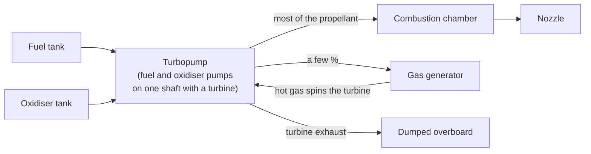

# Rocket engines

A rocket engine produces thrust by throwing mass backwards at high speed. By Newton's third law the vehicle is pushed forwards, with no need for air to push against, which is why rockets work in space.

!!! abstract "In one sentence"
    Burn (or otherwise heat) propellant to make hot, high-pressure gas, then let it expand through a nozzle so it leaves as fast as possible; the faster the exhaust, the less propellant you need.

## Thrust

Thrust comes from two terms: the momentum of the exhaust and the pressure difference at the nozzle exit.

$$
F = \dot{m}\, v_e + (p_e - p_a)\, A_e
$$

| Symbol | Meaning | SI unit |
|---|---|---|
| $F$ | thrust | N |
| $\dot{m}$ | propellant mass flow rate | kg/s |
| $v_e$ | exhaust velocity at the nozzle exit | m/s |
| $p_e$ | gas pressure at the nozzle exit | Pa |
| $p_a$ | ambient (outside) pressure | Pa |
| $A_e$ | nozzle exit area | m² |

The first term dominates. The pressure term is why the same engine gives more thrust in vacuum ($p_a = 0$) than at sea level.

### Worked example

An engine burns $\dot{m} = 250$ kg/s with $v_e = 3000$ m/s, and its nozzle has $A_e = 1$ m² with exit pressure $p_e = 60$ kPa.

- At sea level ($p_a = 101.3$ kPa): $F = 250 \cdot 3000 + (60 - 101.3) \cdot 10^3 \cdot 1 \approx 709$ kN
- In vacuum: $F = 750 + 60 = 810$ kN

The engine gains about 14 % thrust on its way to space, just from the falling outside pressure.

## Specific impulse

Specific impulse $I_{sp}$ measures efficiency: how much impulse (thrust × time) you get per unit of propellant. It is usually quoted in seconds:

$$
I_{sp} = \frac{F}{\dot{m}\, g_0}
\qquad\Longleftrightarrow\qquad
c = I_{sp}\, g_0
$$

where $g_0 = 9.80665$ m/s² is standard gravity and $c$ is the **effective exhaust velocity** (the exhaust velocity with the pressure term folded in). With $I_{sp} = 300$ s, 1 kg of propellant can produce a thrust equal to its own weight on Earth (9.8 N) for 300 s.

!!! tip "Thrust vs efficiency"
    Thrust and $I_{sp}$ are different things. Solid boosters have high thrust and modest $I_{sp}$; ion engines have tiny thrust and enormous $I_{sp}$. Lifting off needs thrust greater than weight; going far needs high $I_{sp}$.

## The rocket equation

How much can a rocket change its speed? Integrating Newton's second law for a vehicle that loses mass as it burns gives the **Tsiolkovsky rocket equation** (1903):

$$
\Delta v = c \,\ln \frac{m_0}{m_f}
$$

| Symbol | Meaning |
|---|---|
| $\Delta v$ | change in velocity ("delta-v") with no gravity or drag |
| $c$ | effective exhaust velocity, $I_{sp}\, g_0$ |
| $m_0$ | initial mass (with propellant) |
| $m_f$ | final mass (dry: structure, engines, payload) |
| $m_0 / m_f$ | mass ratio |

### Where it comes from

In a short time $dt$ the rocket ejects mass $dm$ backwards at speed $c$ relative to itself. Momentum conservation gives $m\, dv = -c\, dm$. Divide by $m$ and integrate from $m_0$ to $m_f$:

$$
\int_0^{\Delta v} dv = -c \int_{m_0}^{m_f} \frac{dm}{m}
\quad\Rightarrow\quad
\Delta v = c \ln \frac{m_0}{m_f}
$$

### Worked example: why rockets are mostly propellant

Reaching low Earth orbit takes about 9.4 km/s of Δv: 7.8 km/s of orbital speed plus roughly 1.6 km/s lost to gravity and drag. With a good kerosene engine, $I_{sp} = 350$ s, so $c \approx 3430$ m/s:

$$
\frac{m_0}{m_f} = e^{\Delta v / c} = e^{9400 / 3430} \approx 15.5
$$

So 93.5 % of the lift-off mass must be propellant, leaving 6.5 % for tanks, engines, avionics *and* payload. A single stage can barely do it, which is why launch vehicles use **staging**: drop empty tanks and heavy engines on the way up, so the later stages do not carry dead weight. The Δv of the stages adds up:

$$
\Delta v_\text{total} = \sum_i c_i \ln \frac{m_{0,i}}{m_{f,i}}
$$

Because Δv depends on the *logarithm* of the mass ratio but *linearly* on $c$, raising $I_{sp}$ is far more effective than trying to build lighter tanks.

## Nozzles

The nozzle turns the heat and pressure of the combustion gas into speed. It is a **converging–diverging** (de Laval) nozzle:

The counter-intuitive part: in supersonic flow a gas speeds up when the channel *widens*. At the throat the flow reaches exactly Mach 1 and the nozzle is **choked**: the mass flow is set by the chamber conditions and throat area alone. The flow obeys the compressible [Euler equations](../mechanics/euler-equations.md); for steady isentropic flow they give the ideal exhaust velocity:

$$
v_e = \sqrt{\frac{2\gamma}{\gamma - 1}\,\frac{R\, T_c}{M}\left[1 - \left(\frac{p_e}{p_c}\right)^{(\gamma-1)/\gamma}\right]}
$$

| Symbol | Meaning |
|---|---|
| $T_c$, $p_c$ | chamber temperature and pressure |
| $M$ | molar mass of the exhaust gas |
| $R$ | universal gas constant, 8.314 J/(mol·K) |
| $\gamma$ | ratio of specific heats of the exhaust |

What the formula says:

- **Hot, light exhaust is best**: $v_e \propto \sqrt{T_c / M}$. This is why hydrogen engines, whose exhaust is mostly light water vapour and unburnt hydrogen, lead chemical $I_{sp}$.
- **Expand as far as possible**: a lower $p_e / p_c$ (a bigger nozzle) means more speed, with diminishing returns.

For example, a hydrogen–oxygen exhaust with $T_c = 3500$ K, $M = 13.5$ g/mol and $\gamma = 1.2$ gives $v_e \approx 3720$ m/s ($I_{sp} \approx 380$ s) at a pressure ratio of 100, and about 4210 m/s (430 s) at a ratio of 1000.

### Expansion and altitude

A nozzle works best when the exit pressure equals the outside pressure, $p_e = p_a$:

| Condition | What happens |
|---|---|
| $p_e > p_a$ (under-expanded) | The plume keeps expanding outside the nozzle; energy is wasted. Normal high in the atmosphere and in vacuum. |
| $p_e = p_a$ (ideally expanded) | Maximum thrust for that altitude. |
| $p_e < p_a$ (over-expanded) | The outside air squeezes the plume; strongly over-expanded nozzles suffer flow separation, side loads and vibration. |

So first-stage engines use short **sea-level nozzles**, and upper-stage engines use huge **vacuum nozzles** with area ratios of 100 or more. Designs such as the **aerospike** adapt automatically to altitude; they have been tested many times but are not yet used on operational orbital launchers.

## Types of rocket engine

| Type | How it works | Typical $I_{sp}$ (vacuum) | Examples |
|---|---|---|---|
| Solid | Fuel and oxidiser mixed in a rubbery solid grain that burns from the inside | 250–290 s | Space Shuttle SRB, Ariane 5 EAP, model rockets |
| Liquid bipropellant | Fuel and oxidiser stored separately and pumped into a chamber | 300–465 s | Merlin, RS-25, Raptor, RD-180 |
| Monopropellant | One propellant decomposed over a catalyst | 220–235 s | Hydrazine attitude thrusters |
| Hybrid | Solid fuel, liquid or gaseous oxidiser | 250–330 s | SpaceShipOne |
| Electric (ion, Hall) | Ionised gas accelerated by electric or magnetic fields | 1500–5000 s | Dawn, Starlink satellites |
| Nuclear thermal | Hydrogen heated by a fission reactor | 850–950 s | NERVA (ground tests only) |

**Solids** are simple, dense and can be stored for years, but cannot normally be shut down or throttled once lit. **Liquids** can be throttled, shut down and restarted, and give higher $I_{sp}$, at the cost of pumps, valves and plumbing. **Electric** engines are extremely efficient but produce millinewtons to newtons of thrust, so they are used only in space, firing for weeks or months.

## Liquid propellants

| Propellant pair | Vacuum $I_{sp}$ | Fuel density | Notes |
|---|---|---|---|
| LOX / kerosene (RP-1) | 310–350 s | 810 kg/m³ | Dense, storable fuel, compact tanks; soot (coking) in engines |
| LOX / methane | 330–380 s | 420 kg/m³ | Burns clean, good for reuse; can be made on Mars |
| LOX / liquid hydrogen | 420–465 s | 71 kg/m³ | Highest chemical $I_{sp}$, but huge, very cold tanks |
| N₂O₄ / hydrazines (UDMH, MMH) | 280–340 s | 790–880 kg/m³ | Storable at room temperature, **hypergolic** (ignite on contact); very toxic |

LOX (liquid oxygen) has a density of about 1140 kg/m³ and boils at −183 °C. Low-density hydrogen is why hydrogen stages are so large: the high $I_{sp}$ is partly eaten by heavier tanks, which is why many first stages use denser fuels and save hydrogen for upper stages.

## Engine cycles

A liquid engine has to push propellant into a chamber at a pressure higher than the chamber's own. The **cycle** is how it powers the pumps that do this.

| Cycle | How the pumps are driven | Trade-off | Examples |
|---|---|---|---|
| Pressure-fed | No pumps: tanks are pressurised with helium | Very simple, but heavy tanks and low chamber pressure | Apollo service module engine, many thrusters |
| Gas generator | A little propellant is burnt to spin a turbine, then dumped overboard | Simple and robust; the dumped gas wastes a few % of $I_{sp}$ | F-1, Merlin, Vulcain |
| Staged combustion | The turbine exhaust is fed into the main chamber, so nothing is wasted | High pressure and $I_{sp}$; complex, hot, hard to develop | RS-25 (fuel-rich), RD-180 (oxidiser-rich) |
| Full-flow staged combustion | Two turbines: one fuel-rich, one oxidiser-rich; all propellant goes through both | Highest pressure, cooler turbines; the most complex | Raptor |
| Expander | Fuel absorbs heat while cooling the chamber, boils, and drives the turbine | Clean and reliable; limited in size by how much heat the chamber walls pick up | RL10, Vinci |
| Electric pump-fed | Batteries drive electric motors on the pumps | Simple; batteries are heavy, so only small engines | Rutherford (Electron) |

*Gas-generator cycle. In staged combustion, the turbine exhaust goes into the combustion chamber instead of overboard.*

## Keeping the engine from melting

Combustion gas is at 3000–3600 K, far above the melting point of any practical metal. Chambers and nozzles survive by one or more of:

- **Regenerative cooling**: propellant (usually fuel) flows through channels in the chamber wall before being burnt, carrying the heat back into the engine.
- **Film cooling**: a thin layer of fuel is injected along the wall to shield it.
- **Ablative cooling**: the wall is made of a material that chars and erodes away slowly, carrying heat with it.
- **Radiative cooling**: the nozzle extension glows red-hot and radiates heat to space; common on vacuum nozzles made of niobium or carbon composites.

## Further reading

- G. P. Sutton and O. Biblarz, *Rocket Propulsion Elements*: the standard textbook
- J. D. Clark, *Ignition! An Informal History of Liquid Rocket Propellants*: an entertaining history of propellant chemistry
- NASA Glenn Research Center, *Beginner's Guide to Rockets*
